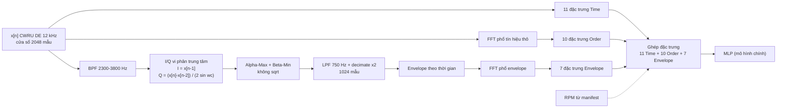

# Giải điều chế envelope nhân quả không FFT cho chẩn đoán lỗi vòng bi trên STM32F4

> Khảo sát đánh đổi giữa **độ trung thực của đường bao** và **chi phí triển khai** của khối giải điều chế Hybrid so với FFT Hilbert trong pipeline DSP + Edge AI chẩn đoán lỗi vòng bi. Benchmark hiện có là trên PC; đo chi phí trên STM32F4 là bước tiếp theo. Dữ liệu: CWRU Drive-End 12 kHz.

| | |
|---|---|
| **Dataset** | CWRU Bearing Data Center, Drive-End, 12 kHz, 4 lớp |
| **Nền tảng** | STM32F4 (Cortex-M4F). Part number, xung nhịp, toolchain: `[TBD]` |
| **Phương án so sánh** | **Hybrid**, tham chiếu FFT Hilbert toàn file trên PC, và FFT Hilbert theo block 2048 mẫu mô phỏng bằng Python (gọi tắt **Hilbert Block**; chưa phải firmware MCU) |
| **Mô hình chính** | MLP trên 28 đặc trưng thủ công |
| **Trạng thái** | Notebook DSP 06 đã chạy đủ 40/40 file; MLP đã đánh giá 3 phương pháp trên cùng 10 seed. Nhánh INT8 đã được sửa và đánh giá file/window-level trên PC; báo cáo ở `reports/INT8_FIX_REPORT.md`. Hilbert Block vẫn là mô phỏng Python; **chưa có firmware hoặc số đo STM32F4**. |

---

## 1. Tóm tắt

Biến đổi Hilbert qua FFT cho đường bao tham chiếu; notebook cũng mô phỏng Hilbert theo block 2048 mẫu trên PC để so fidelity. Dự án đề xuất một khối giải điều chế envelope **nhân quả, không FFT** cho vi điều khiển; port và đo trên board chưa được thực hiện. Claim "không FFT" chỉ nói về phép tạo envelope Hybrid; FFT vẫn được dùng riêng ở bước trích đặc trưng phổ, bao gồm Order và Envelope:

1. Tín hiệu đi qua BPF **2300-3800 Hz** (tâm ≈ 3050 Hz, gần fs/4).
2. Cặp trực giao được tạo bằng **vi phân trung tâm chuẩn hóa**: `I[n] = x[n-1]`, `Q[n] = (x[n] - x[n-2]) / (2·sin ωc)`.
3. Biên độ tính bằng **Alpha-Max Plus Beta-Min**, không dùng căn bậc hai.
4. Đường bao qua **LPF 750 Hz** rồi **decimate ×2** (1024 mẫu), sau đó trích 7 đặc trưng envelope cho MLP.

Đóng góp là một **đánh đổi được lượng hóa**, không phải tuyên bố tối ưu:

- **Tài nguyên:** mục tiêu là đo chu kỳ, Flash, SRAM của Hybrid so với Hilbert trên cùng board, theo từng giai đoạn của pipeline (RQ1); hiện chưa có số đo phần cứng.
- **Tương đương benchmark:** độ trung thực đường bao và chất lượng chẩn đoán của Hybrid không kém Hilbert quá một biên chọn trước (RQ2).
- **Giao thức:** đánh giá MLP theo giao thức chống rò rỉ dữ liệu, so sánh cặp trên cùng fold và seed.

## 2. Điểm nhấn

- **Không FFT trong khối giải điều chế.** Không đệm khối, không số phức, trạng thái chỉ 2 mẫu.
- **Không sqrt ở nhánh Hybrid.** Biên độ đường bao tính bằng `α·max + β·min`.
- **Rất rẻ theo cấu trúc.** Khối I/Q cần 1 phép trừ và 1 phép nhân mỗi mẫu. Trễ nhóm là 1 mẫu (≈ 83 µs ở 12 kHz). Độ lệch pha đúng 90° ở mọi tần số.
- **Hợp với dải cộng hưởng đã chọn.** Tâm dải gần fs/4, nơi bộ vi phân 3 tap gần lý tưởng nhất (mục 4.2).
- **Có đối chứng Hilbert theo block trên PC.** Notebook 06 so sánh Hybrid và mô phỏng Hilbert Block 2048 mẫu, float32 với cùng tham chiếu offline. Đây chưa phải triển khai MCU; chu kỳ DWT, SRAM và Flash vẫn chưa được đo.
- **Giao thức đánh giá chống rò rỉ.** File là đơn vị chia tập, manifest cố định, stratified group k-fold lặp N seed với cùng tập seed cho mọi phương án (so sánh cặp).
- **Báo cáo trung thực giới hạn.** Độ nghiêng biên độ, phụ thuộc RPM, phạm vi CWRU, méo biên của Hilbert theo khối đều được nêu và đo, không giấu.

## 3. Pipeline

### 3.1. Thứ tự khóa dữ liệu và cấu hình

1. **Lập manifest từ dữ liệu gốc:** kiểm tra nhãn, tải, vị trí cảm biến, số mẫu, sampling rate và RPM; lọc scope rồi lưu manifest kèm SHA-256. Mọi bước tiếp theo dùng metadata đã chốt trong manifest, không tự suy ra lại RPM hay sampling rate.
2. **Rà miền thời gian:** kiểm tra chất lượng tín hiệu sau resample về 12 kHz (độ dài, biên độ, clipping, đoạn bất thường và transient). Bước này xác nhận dữ liệu dùng được; không tự chọn bandpass từ một file đại diện.
3. **Rà miền tần số:** so sánh phổ trên các lớp lỗi và tải trong tập được phép dùng để thiết kế; không dùng file Test để chọn band. Các band theo từng loại lỗi trong `outputs/configs/bands/` chỉ là kết quả khảo sát.
4. **Khóa một bandHz chung:** dùng **2300–3800 Hz** cho mọi lớp/tải. Không chọn band theo từng file hoặc nhãn trong pipeline chính. Đây là cấu hình thực nghiệm đã chốt, đồng thời đặt dải cộng hưởng gần fs/4 cho khối Hybrid; không tuyên bố đây là band tối ưu phổ quát.
5. **Build feature:** resample theo manifest, tính envelope trên toàn file để giữ trạng thái lọc, cắt raw/envelope đồng vị trí sau warm-up, dùng FFT để trích đặc trưng phổ Order và Envelope, rồi tạo 28 đặc trưng (11 Time + 10 Order + 7 Envelope).
6. **Đo độ trung thực đường bao (PC):** notebook 06 so Hybrid và Hilbert Block 2048 (mô phỏng Python) với tham chiếu Hilbert toàn file theo nhóm chỉ số A (mục 8.1). Đo lag **trước** khi căn chỉnh; Pearson và NRMSE tính **sau** căn chỉnh. Nhóm D tổng hợp từ cùng kết quả.
7. **So sánh phân loại:** notebook MLP dùng 28 đặc trưng, cùng manifest, cửa sổ, fold/seed cho Hybrid, Hilbert offline và Hilbert Block; kết quả tách biệt với fidelity envelope.
8. **Port MCU (chưa thực hiện):** triển khai hai phương án bằng C trên cùng board; **khớp số học PC vs MCU** trước khi đo chu kỳ và bộ nhớ (mục 8.2).



Sơ đồ trên là nhánh Hybrid. Nhánh Hilbert Block thay hai khối "I/Q vi phân" và "Alpha-Max" bằng Hilbert theo block (FFT → mặt nạ giải tích → IFFT → độ lớn) trên cửa sổ 2048 mẫu. Notebook hiện mô phỏng nhánh này bằng Python; các khối lọc/chia mẫu được dùng chung.

### 3.2. Các nhánh so sánh (cùng BPF, LPF, decimate)

| Nhánh | Vai trò | Ghi chú |
|---|---|---|
| **Hybrid** (I/Q vi phân + Alpha-Max) | Phương án đề xuất | Nhân quả, theo dòng mẫu; xấp xỉ biên độ không cần căn bậc hai |
| **FFT Hilbert, tham chiếu PC** (masking bin dương, toàn file) | Thước đo độ trung thực | Không nhân quả, xử lý trên cả file (`scipy.signal.hilbert`). Không phải số đo MCU |
| **Hilbert Block** (FFT theo khối 2048 mẫu, float32) | Đối chứng fidelity trên PC; đại diện thuật toán dự kiến port MCU | RFFT, mặt nạ giải tích, IFFT phức, độ lớn bằng căn bậc hai. Đây là mô phỏng Python, chưa có mã C hoặc số đo MCU; méo biên block được đo ở mục 9 |

### 3.3. Khác biệt giữa tham chiếu PC và Hilbert Block

Hai nhánh dùng cùng thuật toán (FFT, giữ DC và Nyquist, nhân đôi bin dương, xóa bin âm, IFFT, lấy độ lớn). Chúng khác nhau ở độ dài khối, kiểu số và vai trò trong báo cáo.

| Tiêu chí | FFT Hilbert, tham chiếu PC | Hilbert Block (mô phỏng Python) |
|---|---|---|
| Cài đặt | `scipy.signal.hilbert` trên toàn file | FFT theo block trong Python |
| Độ dài FFT | Toàn bộ file | Khối cố định 2048 mẫu |
| Kiểu số | float64 | float32 |
| Nhân quả | Không, cần thấy cả file | Không, cần đủ một khối 2048 mẫu |
| Méo biên | Chỉ ở hai đầu file, được loại bằng warm-up và trim | Ở hai đầu **mỗi khối** (FFT coi tín hiệu tuần hoàn), nên phần tín hiệu dùng được đã bị méo |
| Căn bậc hai | Chính xác | `sqrt` trong mô phỏng Python |
| Vai trò | Thước đo độ trung thực (Bảng 1) | Đối chứng fidelity PC (Bảng 1); chưa đo chi phí MCU |
| Đo chu kỳ, Flash, SRAM | Không; số trên PC không phải chi phí MCU | Chưa có |

Tham chiếu toàn file không phải chân lý tuyệt đối cho bản triển khai block: Hilbert Block sẽ không trùng nó dù cài đặt đúng, vì chênh lệch đến từ độ dài block. Mô phỏng Python hiện dùng để so fidelity; khi port MCU vẫn cần kiểm tra khớp số học PC–MCU trước khi đo chu kỳ.

> **Phạm vi của claim "không FFT":** chỉ áp dụng cho khối giải điều chế/tạo envelope Hybrid. Trích đặc trưng phổ vẫn dùng FFT: Order tính trên phổ tín hiệu thô và Envelope tính trên phổ của envelope. Vì vậy toàn bộ pipeline **có sử dụng FFT**; chỉ riêng khối tạo envelope Hybrid là không FFT. Chi phí FFT của các bước trích đặc trưng được tính riêng, không gộp vào claim về giải điều chế.

## 4. Thông số DSP

### 4.1. Bảng thông số

| Thông số | Giá trị | Ghi chú |
|---|---|---|
| fs | 12 kHz | Các file Normal 48 kHz được hạ về 12 kHz bằng polyphase |
| Cửa sổ | 2048 mẫu (170,67 ms) | Stride: 1024 mẫu |
| BPF (dải cộng hưởng) | **2300-3800 Hz**, cố định cho mọi lớp và tải | Butterworth bậc 4, causal SOS. Nguồn chọn dải và tập dùng để chọn cần ghi trong báo cáo; không dùng file Test |
| ωc | Chế độ `minimax` (sin ωc ≈ 0,9568) | Giảm sai lệch tương đối lớn nhất của gain Q trên dải; `center` là đối chứng trong `00_hybrid_testing.ipynb` |
| Alpha-Max | α = 0,960433870103; β = 0,397824734759 | Tối ưu sai số cực đại, theo hằng số hiện hành trong `src.dsp` |
| LPF | **750 Hz** | Butterworth bậc 2, causal SOS. Giữ tối thiểu hài bậc 3 của BPFI (mục 4.3) |
| Decimate | **×2** → fs_env = 6 kHz, **1024 mẫu** | Cấu hình chính; không quét thêm hệ số giảm mẫu trong phạm vi hiện tại |
| Hilbert Block | Khối N = 2048 mẫu, float32 trong mô phỏng Python | Dùng chung BPF, LPF, DC blocker, decimate với Hybrid; thư viện FFT và cấu hình firmware MCU chưa được chốt |

Biên độ xấp xỉ:

```
|z| ≈ α·max(|I|, |Q|) + β·min(|I|, |Q|)
```

### 4.2. Độ nghiêng biên độ của khối I/Q

Với `x = cos(ωn)`, `Q/I` có biên độ `s = sin ω / sin ωc` và lệch pha đúng 90°. Độ nghiêng `s` là điểm yếu của phương án này. Bảng dưới là **ước lượng giải tích** với ωc `minimax` đã khóa (sin ωc = 0,9568) trên dải 2300-3800 Hz, chưa phải số đo. Với chế độ `center` thì s ≈ 1 tại 3050 Hz.

| Tần số | s = sinω / sinωc | Độ nghiêng (s − 1) | Image rejection ≈ ((1-s)/(1+s))² |
|---|---|---|---|
| 2300 Hz | 0,9758 | −2,4% | 1,5·10⁻⁴ (≈ −38,2 dB) |
| 3050 Hz | 1,0448 | +4,5% | 4,8·10⁻⁴ (≈ −33,2 dB) |
| 3800 Hz | 0,9548 | −4,5% | 5,3·10⁻⁴ (≈ −32,7 dB) |

Trong kết quả notebook 06, Peak Amplitude Error trung vị của Hybrid là khoảng +0,19 đến +0,22 dB theo thành phần lỗi (mục 9). Đây phù hợp với độ lệch biên độ nhỏ dự kiến; không diễn giải con số này như đo gain trên MCU.

### 4.3. Kiểm tra LPF 750 Hz với tần số lỗi

Theo hệ số công bố BPFI ≈ 5,415 × f_r (cần xác nhận trước khi trích dẫn), ở 1797 rpm (f_r ≈ 29,95 Hz):

| | Tần số |
|---|---|
| BPFI | ≈ 162 Hz |
| Hài bậc 3 | ≈ 487 Hz |
| Hài bậc 4 | ≈ 649 Hz (sát vùng chuyển tiếp, phụ thuộc độ dốc LPF) |
| Hài bậc 5 | ≈ 811 Hz (ngoài băng) |

## 5. Dữ liệu và manifest

**Nhãn 4 lớp:** Normal + 3 vị trí lỗi (IR, B, OR) × 3 đường kính (7, 14, 21 mil). Gom chung các mức tải 0, 1, 2, 3 HP. (4 lớp: Normal, IR, OR, B)

Manifest chuẩn được tạo từ dữ liệu gốc, lọc theo scope, gắn fold và băm SHA-256 trước khi build feature. Cột RPM dùng cho đặc trưng được quyết định tại bước manifest: ưu tiên RPM đọc từ file nếu hợp lệ, nếu không dùng RPM danh định theo tải và ghi rõ nguồn. Feature builder không tự tính lại hoặc thay thế RPM.

| Cột | Ý nghĩa |
|---|---|
| `file_path` | Đường dẫn file `.mat` nguồn |
| `label`, `load_hp`, `fault_diameter_mils`, `or_position` | Nhãn và metadata dùng để xác định scope/lớp |
| `declared_sample_rate_khz`, `resolved_sample_rate_hz` | Tần số khai báo và tần số được xác thực từ metadata/số mẫu |
| `rpm_from_file`, `rpm` | RPM gốc đọc được và RPM thống nhất dùng cho đặc trưng |
| `rpm_source` | `measured` hoặc `imputed:<quy tắc>` |
| `warnings`, `has_warning`, `manifest_schema_version` | Kết quả sanity check và phiên bản schema |
| `fold_seed_<seed>` | Fold của file ứng với từng seed; các cửa sổ sau đó kế thừa fold qua `file_id` |

**Quy tắc:**
- Quy tắc RPM thiếu hiện tại là RPM danh định theo tải (`NOMINAL_RPM_BY_LOAD`); nguồn điền được ghi trong `rpm_source`. Nếu không có RPM hợp lệ cũng không xác định được tải thì dừng, không dùng giá trị mặc định ngầm.
- Manifest sau scope/fold được băm (SHA-256) và ghi vào log mỗi lần chạy. Bảng feature bổ sung `file_id` (stem, không chứa chỉ số cửa sổ), `window_idx` và `start_idx`.
- Nếu RPM được điền theo tải danh định thì RPM tương quan với tải. Khảo sát độ nhạy khi RPM lệch ±2% được đưa vào thực nghiệm.
- Loại lỗi (Normal / IR / OR / Ball) dùng cho nhóm D được suy ra từ cột metadata nếu có, rồi từ nhãn, rồi từ tên file; nhãn không nhận ra được gán `Unknown` và bị loại khỏi bảng theo loại lỗi kèm cảnh báo.

**Lưu ý dữ liệu đã kiểm tra:**
- `97_Normal_0.mat` được xác nhận là 48 kHz: phổ tương quan với các file Normal 48 kHz khác (≈ 0,73) và đỉnh 1× khớp RPM trong file; giả thiết 12 kHz hoặc 24 kHz không khớp. File này ngắn hơn khoảng một nửa các file Normal còn lại do dữ liệu gốc ngắn hơn.
- `99_Normal_2.mat` chứa hai biến DE (`X098_DE_time` và `X099_DE_time`). Loader phải chọn biến theo số hiệu file (`X099`); lấy biến đầu tiên sẽ nạp trùng dữ liệu của file 98 và gây rò rỉ giữa các fold.

**Kiểm kê hiện tại:** 40 file trong scope, 4 file cho mỗi lớp 10-class. Số lượng theo tải cần lấy từ manifest đã sinh; không giả định mọi lớp đều có cùng số file ở từng tải.

## 6. Giao thức đánh giá

| Mục | Thiết kế |
|---|---|
| **Giao thức** | **Stratified group k-fold, nhóm = `file_id`**: mỗi file được test đúng một lần trong một seed; mọi cửa sổ cùng file ở cùng fold. Phân tầng theo 10 lớp chi tiết, 4 file/lớp; nhãn đánh giá gộp thành 4 lớp và `k = 4` |
| **Lặp N seed** | Mỗi seed ứng với một cách phân hoạch fold và một khởi tạo MLP. Dùng seed 42–51 (`N = 10`), báo cáo đủ cả 10 lần. Hybrid và Hilbert dùng cùng tập seed/fold để so sánh cặp |
| **Điều kiện kiểm kê** | Chỉ chạy được khi mỗi lớp có ≥ k file (bảng kiểm kê, mục 5). Nếu có lớp ít file hơn thì giảm k |
| **Chỉ fit trên Train** | Z-score và siêu tham số học được. Cấu hình DSP (BPF, ωc, α/β) phải chốt từ trước, không chọn dựa trên Test |
| **Chọn mô hình / early stopping** | Notebook MLP dùng kiến trúc cố định `28 → 32 → 16 → 4`, 40 epoch, không dùng Val và không early stopping; không chọn theo Test |
| **Báo cáo** | **Macro-F1** (chỉ số chính), **Accuracy** (chỉ số phụ) và **confusion matrix**, gộp theo file qua k fold của mỗi seed. Macro-F1 và Accuracy trình bày dưới dạng trung bình ± độ lệch chuẩn qua các lần đánh giá hiện có (N seed × k fold); đây là cách trình bày độ ổn định, không phải metric mới. Bất định chính lấy từ CI bootstrap theo file. Không tính std trên cửa sổ |
| **Không dùng p-value từ N seed** | Đơn vị độc lập là file; các seed dùng chung file Test nên không độc lập. Bất định theo file lấy từ bootstrap theo file |
| **Chống ceiling effect** | Notebook MLP đã quét AWGN trên tín hiệu thô tại 20, 12, 8, 4 và 0 dB; kết quả tóm tắt ở mục 9 |

**Giới hạn đã biết của giao thức:** cùng một vòng bi hỏng xuất hiện ở cả 4 mức tải, nên file Test luôn có file "cùng lỗi, khác tải" nằm trong Train. Kết quả chỉ nói về file chưa thấy trong cùng mẫu vật với tải gộp chung, và **không tuyên bố tổng quát hóa qua tải hay qua vòng bi/máy khác**. Notebook đã có một phép khảo sát AWGN theo SNR (mục 9); không suy rộng từ đó thành kiểm định robustness phổ quát.

## 7. Mô hình và export

| Phần | Mục đích | Protocol / artifact |
|---|---|---|
| **Cell 5 — Huấn luyện/đánh giá theo fold** | So sánh MLP cho Hybrid, Hilbert offline và Hilbert Block | MLP học từ feature theo window; metric chính được gộp theo `file_id`. Mỗi fold giữ toàn bộ file test tách khỏi train. |
| **Cell export — mô hình triển khai** | Chọn phương pháp theo Macro-F1 CV, fit lại scaler và MLP cuối trên toàn bộ feature table, sau đó export | Kiến trúc `28 → 32 → 16 → 4`, 40 epoch. Đây là final fit sau CV, không phải một model fold/test riêng. Artifact INT8 mới nhận 28 feature đã chuẩn hóa. |
| **Cell P0 INT8 — đánh giá lượng tử hóa** | Đánh giá Keras Float32, TFLite Float32 và TFLite INT8 | Chạy lại riêng nhánh Hybrid qua cùng file folds; báo cáo cả file-level và window-level. Representative calibration chỉ dùng train files của fold. Cell này không phải cell export final model. |

Trong `summary.csv` hiện tại, ba phương pháp có cùng điểm CV; chọn bằng sort ổn định nên phương pháp đầu tiên là `hybrid`. Vì vậy final artifact hiện tại dùng 28 feature Hybrid. Notebook cũ và artifact legacy được giữ để đối chiếu; nhánh sửa lưu riêng tại `model_export_int8_revised/`.

MLP hiện là classifier tham chiếu cố định để so sánh DSP và tài nguyên. Không đổi kiến trúc giữa các phương pháp DSP trong cùng một benchmark.

## 8. Bộ chỉ số benchmark chính thức

### 8.1. Bốn nhóm, mười bốn chỉ số

| Nhóm | Chỉ số | Trả lời câu hỏi |
|---|---|---|
| **A. DSP Fidelity** (5) | Pearson ρ; NRMSE; Peak Amplitude Error (dB); Envelope Spectrum Error; Relative lag | Đường bao Hybrid giống tham chiếu đến đâu? |
| **B. Chất lượng chẩn đoán** (3) | Macro-F1; Accuracy; Confusion matrix | Thay Hilbert bằng Hybrid có làm đổi kết quả chẩn đoán không? |
| **C. Embedded Benchmark** (4) | DSP cycles; Total diagnostic cycles; Flash; SRAM | Hybrid rẻ hơn Hilbert-MCU bao nhiêu? |
| **D. Robustness** (2) | Pearson theo lớp; Pearson theo tải | Độ trung thực có đều qua các lớp và tải không? |

#### A. DSP Fidelity

So Hybrid và Hilbert Block (mô phỏng Python theo cửa sổ, đại diện cho phương án dự kiến port MCU) với tham chiếu Hilbert toàn file trên PC, cùng BPF/LPF, warm-up và trim biên. Đây là benchmark fidelity trên PC; chưa có phép đo từ firmware MCU.

| # | Chỉ số | Định nghĩa | Ghi chú |
|---|---|---|---|
| 1 | **Pearson ρ, sau căn chỉnh trễ** | Hệ số tương quan giữa đường bao và tham chiếu sau khi dịch theo lag đo được, trên vùng hợp lệ chung | Chỉ phản ánh độ giống về biến thiên, không phản ánh lệch độ lớn |
| 2 | **NRMSE, sau căn chỉnh, không khớp gain** | `RMS(y − r) / RMS(r)` trên đầu ra sau LPF và DC blocker | Không khớp gain nên nhạy với lệch scale; chỉ diễn giải khi hai đại lượng cùng đơn vị biên độ |
| 3 | **Peak Amplitude Error (dB)** | `20·log10(A_y / A_r)` tại `h·f_lỗi` (h = 1–3) của BPFI, BPFO, BSF và FTF | Tính trên phổ **chưa chuẩn hóa**, cùng đoạn dữ liệu, cùng cửa sổ Hann. Chỉ ghi giá trị khi: (i) đỉnh tham chiếu nổi bật (≥ 3 lần nền lân cận, nền là trung vị trong ±15 Hz, loại cửa sổ tìm đỉnh ±3 Hz, và đỉnh ≥ 10⁻³ lần đỉnh lớn nhất của phổ tham chiếu); (ii) độ phân giải phổ đủ (Δf ≤ 1 Hz và Δf ≤ f/10); (iii) Hybrid có đỉnh dương trong cửa sổ tìm. Ngược lại ghi **NaN**, không ghi 0, kèm lý do ở `peak_invalid_reason`. Dấu dương: Hybrid cao hơn tham chiếu. Bản ghi Normal không có đỉnh lỗi thật nên bị loại khỏi bảng headline |
| 4 | **Envelope Spectrum Error** | `‖S_y − S_r‖₂ / ‖S_r‖₂` trên 0–500 Hz (bỏ bin DC) | **Cùng dải tần, cùng độ phân giải, cùng cửa sổ.** Báo hai biến thể: **(a) chuẩn hóa chung theo đỉnh phổ tham chiếu** (`ref_norm`, chỉ số chính, giữ chênh lệch biên độ); **(b) mỗi phổ chuẩn hóa theo đỉnh riêng** (`own_norm`, chỉ đo hình dạng). Kèm hệ số Pearson giữa hai phổ như thông tin phụ |
| 5 | **Relative lag** | Lag giữa đầu ra và tham chiếu, **đo trước căn chỉnh**, báo bằng mẫu và µs: `lag_µs = lag_mẫu / fs × 10⁶` (1 mẫu = 83,3 µs ở 12 kHz) | Lag > 0: đầu ra trễ hơn tham chiếu. Báo riêng, không dùng để "bù" ngầm trong chỉ số 1 và 2 |

#### B. Chất lượng chẩn đoán

1. **Macro-F1**: chỉ số chính.
2. **Accuracy**: chỉ số phụ.
3. **Confusion matrix**: xem các lớp bị nhầm lẫn.

Báo cáo Macro-F1 và Accuracy trung bình ± độ lệch chuẩn qua các lần đánh giá hiện có (mục 6). Đây là cách trình bày độ ổn định, không phải bổ sung một metric mới. Hybrid và Hilbert dùng cùng manifest, cửa sổ, fold và seed.

#### C. Embedded Benchmark

Khi có firmware, đo Hybrid và Hilbert-MCU trên cùng board, cùng điều kiện (mục 8.2). Hiện các chỉ số này chưa có số liệu.

1. **DSP cycles**: chu kỳ của riêng khối tạo envelope cho một cửa sổ 2048 mẫu (Hybrid: I/Q và độ lớn; Hilbert-MCU: FFT, mặt nạ, IFFT, độ lớn). BPF/LPF dùng chung báo riêng.
2. **Total diagnostic cycles**: DSP (BPF, envelope, LPF, decimate) + trích đặc trưng + suy luận MLP, cho một cửa sổ.
3. **Flash usage**: toàn firmware (`.text` + `.rodata`), gồm bảng twiddle và runtime. Trọng số mô hình báo riêng.
4. **SRAM usage**: ưu tiên báo cả mức dùng tĩnh (`.data` + `.bss`) và đỉnh khi chạy (gồm stack, đo bằng stack watermark) nếu đo được.

Các đại lượng suy ra từ chu kỳ (thời gian = chu kỳ / f_clk, duty cycle = `cycles_diag / (f_clk × 170,67 ms)`, tiêu chí real-time `t_diag < stride / fs`) không phải metric mới. Chỉ dùng từ "real-time" khi tiêu chí thỏa. MACC chỉ báo nếu công cụ xuất được. Energy ngoài phạm vi; chỉ bổ sung nếu có dụng cụ đo dòng và số đo thực, không ước lượng.

#### D. Robustness

1. **Pearson theo lớp**: Normal, IR, OR, Ball (B).
2. **Pearson theo tải**: 0, 1, 2, 3 HP.

Cùng định nghĩa Pearson ở A.1 (Hybrid so với tham chiếu, sau căn chỉnh). Báo trung bình ± độ lệch chuẩn theo file kèm số file mỗi nhóm (Normal chỉ có 4 file). Kèm **NRMSE trung bình** của từng nhóm (và lag µs, sai số phổ) để kiểm tra sai số có đổi theo loại lỗi hoặc tải hay không; đây là mở rộng từ kết quả nhóm A, không cần chạy lại thuật toán. Nhóm không có file hiển thị `n_files = 0`, không bị bỏ ngầm.

### 8.2. Kế hoạch đo đạc trên STM32F4

**Trạng thái hiện tại:** chưa có port C/firmware, board đo hoặc số liệu chu kỳ, Flash, SRAM. Hilbert Block trong notebook là mô phỏng Python, không phải Hilbert-MCU đã triển khai.

**Hilbert-MCU dự kiến** (đối chứng cho Hybrid): RFFT N = 2048 điểm float32, giữ DC và Nyquist, nhân đôi bin dương, xóa bin âm, IFFT phức, lấy độ lớn bằng căn bậc hai; sau đó dùng chung LPF, DC blocker và decimate với Hybrid. Thư viện FFT và phiên bản firmware cần được chốt khi port.

**Điều kiện đo công bằng:**
- Cùng chip, xung nhịp, cờ biên dịch (nêu rõ), cùng cửa sổ đầu vào, cùng BPF/LPF.
- Chu kỳ: DWT `CYCCNT`, trung bình, min, max trên nhiều cửa sổ; loại trừ thời gian I/O và khởi tạo bảng.
- Flash và SRAM: đọc từ map file và `size`, SRAM đỉnh có stack watermark.
- Báo hai mức: **riêng khối tạo envelope** và **toàn pipeline** (mức tiết kiệm ở toàn pipeline có thể nhỏ hơn nhiều vì BPF/LPF dùng chung chiếm phần lớn chu kỳ).

**Kiểm tra bắt buộc trước khi đo:** **khớp số học PC vs MCU** trên cùng cửa sổ (đường bao, đặc trưng, đầu ra mạng), trong sai số chọn trước. Với Hilbert-MCU, bản PC đối chiếu là Hilbert **theo cửa sổ** có cùng cách xử lý biên, không phải Hilbert toàn file.

Không dùng số của Hilbert offline hoặc Hilbert Block chạy trên PC như thể đó là chi phí MCU; chi phí phần cứng chỉ được báo sau khi đo firmware trên board.

### 8.3. Đầu ra của notebook 06 (`outputs/tables/`)

| File | Nội dung |
|---|---|
| `06_waveform_metrics_by_file.csv` | Pearson, NRMSE, lag (mẫu và µs), sai số phổ toàn dải, theo từng file |
| `06_waveform_metrics_summary_by_method.csv` | Tổng hợp Fidelity |
| `06_fault_spectrum_errors_by_file.csv` | Biên độ đỉnh, sai số dB và tần số tại từng tần số lỗi và hài, kèm `peak_invalid_reason` |
| `06_fault_spectrum_error_summary.csv` | Tổng hợp sai số đỉnh theo loại lỗi, thành phần, hài |
| `06_fault_spectrum_headline.csv` | Bảng gọn cho báo cáo: chỉ nhóm Fault, theo thành phần lỗi |
| `06_robustness_by_fault_type.csv` | Pearson, NRMSE theo Normal, IR, OR, Ball |
| `06_robustness_by_load.csv` | Pearson, NRMSE theo tải 0–3 HP |
| `06_dsp_benchmark_errors.csv` | File lỗi hoặc không chạy được (ghi trước các bảng khác) |
| `06_benchmark_params.json` | Tham số benchmark đã dùng |

Notebook 06 chỉ đánh giá fidelity/robustness của đường bao, không tính Macro-F1/Accuracy hoặc chi phí MCU. Phân loại và quét AWGN nằm trong [notebook MLP ba phương pháp](./notebooks/giai_doan_2_model/training_full_mlp_three_methods.ipynb); notebook này không quét BPF.

### 8.4. Đầu ra notebook MLP ba phương pháp

Notebook đọc ba bảng feature `features_mlp_hybrid`, `features_mlp_hilbert` và `features_mlp_hilbert_block` trong `notebooks/giai_doan_1_tien_xu_ly/outputs/tables/`. Kết quả được ghi vào `notebooks/giai_doan_2_model/outputs/training_mlp_three_methods/`, gồm các bảng chính:

| File | Nội dung |
|---|---|
| `summary.csv`, `metrics_by_seed.csv` | Accuracy và Macro-F1 mức file, theo phương pháp và seed |
| `learning_curves_summary.csv` | Tóm tắt loss/accuracy huấn luyện qua các fold |
| `paired_deltas.csv` | So sánh ghép cặp với FFT Hilbert offline |
| `predictions_file_level.csv`, `per_class_recall.csv`, `file_errors.csv` | Dự đoán, recall theo lớp và file phân loại sai |
| `confusion_matrix_sum_over_seeds.csv` | Confusion matrix tổng hợp |
| `noise_summary.csv`, `noise_paired_deltas.csv`, `noise_predictions_file_level.csv` | Kết quả AWGN theo SNR |
| `ablation_summary.csv`, `ablation_deltas.csv` | Ablation nhóm Time / Order / Envelope |
| `run_config.json` | Cấu hình chạy và tham số đánh giá |
| `int8_revised_evaluation/metrics_by_seed.csv` | Keras/TFLite Float32/TFLite INT8; metric theo file và window, từng seed |
| `int8_revised_evaluation/file_predictions.csv`, `window_predictions.csv` | Dự đoán và xác suất theo từng file/window, seed và fold |
| `int8_revised_evaluation/confusion_by_seed.csv` | Confusion matrix theo file/window và từng phiên bản |
| `int8_revised_evaluation/quantization_diagnostics.csv` | Sai số xác suất, input quantization, saturation/clipping theo feature/fold |
| `int8_revised_evaluation/model_sizes.csv`, `file_bootstrap_ci_clustered.csv` | Kích thước flatbuffer theo fold và CI bootstrap theo cụm file |
| `int8_revised_evaluation/confusion_matrices_int8_comparison.png` | Hình confusion matrix chuẩn hóa, lưu bởi cell plot sau cell P0 |
| `model_export_int8_revised/` | TFLite INT8 standardized-input, scaler, metadata và representative samples |

Các bảng kết quả notebook được lưu cùng notebook; các CSV ở trên được tạo khi chạy notebook.

## 9. Kết quả hiện có trên PC

**Bảng 1 — DSP Fidelity trên PC** (nhóm A)

| Phương án (so với tham chiếu FFT Hilbert toàn file) | Số file | Pearson trung bình ± SD | NRMSE trung bình | Envelope Spectrum Error (`ref_norm`, trung bình) | Median absolute lag (mẫu) |
|---|---:|---:|---:|---:|---:|
| Hybrid | 40 | 0,9997 ± 0,0002 | 0,0286 | 0,0297 | 1 mẫu |
| Hilbert Block 2048 (mô phỏng Python) | 40 | 1,0000 ± 0,0000 | 0,0034 | 0,0031 | 0 mẫu |

Lag của Hybrid trung bình là +83,3 µs; Hilbert Block là 0 µs. Envelope Spectrum Error `own_norm` trung bình lần lượt là 0,0140 và 0,0031. Đây là số liệu PC, không phải đo MCU.

Peak Amplitude Error trung vị có dấu của Hybrid: BPFI +0,194 dB, BPFO +0,198 dB, BSF +0,209 dB, FTF +0,217 dB. Với Hilbert Block, các trung vị tương ứng xấp xỉ −0,002, −0,002, −0,001 và 0,000 dB. Số đỉnh hợp lệ là 97 (BPFI), 95 (BPFO), 92 (BSF), 92 (FTF) cho mỗi phương pháp; mỗi bảng được tổng hợp trên nhóm Fault.

Notebook [06_dsp_method_benchmark_three_methods.ipynb](./notebooks/giai_doan_1_tien_xu_ly/06_dsp_method_benchmark_three_methods.ipynb) xử lý thành công **40/40 file, 0 lỗi**. Pearson/NRMSE được tính sau căn chỉnh; lag được đo trước căn chỉnh. Các ngưỡng lọc đỉnh và định nghĩa metric theo mục 8.1.

**Bảng 2 — Ablation DSP:** notebook 06 không triển khai ablation 2×2 I/Q × phép tính độ lớn; không có kết quả định lượng cho phép thử này.

**Bảng 3 — Chất lượng chẩn đoán** (mức file; 10 seed, 40 file; trung bình ± SD giữa seed)

| Phương án | Accuracy | Macro-F1 |
|---|---:|---:|
| Hybrid | 91,75% ± 2,90% | 91,37% ± 3,43% |
| FFT Hilbert offline | 91,75% ± 2,90% | 91,37% ± 3,43% |
| Hilbert Block 2048 | 91,75% ± 2,90% | 91,37% ± 3,43% |

CI bootstrap 95% theo file cho cả ba phương pháp: Accuracy [83,25%; 98,25%], Macro-F1 [80,99%; 98,07%]. Trong kết quả notebook đã lưu, Accuracy và Macro-F1 khớp nhau giữa ba phương pháp ở cả 10 seed; delta ghép cặp của hai chỉ số đều bằng 0 (CI [0; 0]). Đây là kết quả của cấu hình và tập CWRU hiện tại, không chứng minh tương đương phổ quát.

**Ablation đặc trưng Hybrid** được bật trong notebook nhưng chạy 3 seed, nên chỉ mang tính mô tả (không so trực tiếp với kết quả chính 10 seed):

| Biến thể | Số đặc trưng | Accuracy | Macro-F1 |
|---|---:|---:|---:|
| Đủ Time + Order + Envelope | 28 | 93,33% | 92,62% |
| Bỏ Time | 17 | 96,67% | 96,39% |
| Bỏ Order | 18 | 93,33% | 93,90% |
| Bỏ Envelope | 21 | 87,50% | 87,12% |

**Quét AWGN** cộng nhiễu vào tín hiệu thô; mô hình và scaler được fit trên dữ liệu sạch. Accuracy trung bình giữa 10 seed:

| SNR | Hybrid | FFT Hilbert offline | Hilbert Block 2048 |
|---:|---:|---:|---:|
| Clean | 91,75% | 91,75% | 91,75% |
| 20 dB | 91,50% | 91,25% | 91,50% |
| 12 dB | 89,25% | 89,25% | 89,25% |
| 8 dB | 71,25% | 72,25% | 71,50% |
| 4 dB | 43,25% | 44,00% | 43,50% |
| 0 dB | 28,75% | 29,25% | 29,25% |

**Bảng 4 — Embedded Benchmark** (chưa có firmware hoặc số đo board)

| Phương án | DSP cycles (khối envelope) | Total diagnostic cycles | Flash | SRAM tĩnh | SRAM đỉnh |
|---|---|---|---|---|---|
| Hybrid | `[TBD]` | `[TBD]` | `[TBD]` | `[TBD]` | `[TBD]` |
| Hilbert-MCU (chưa đo) | `[TBD]` | `[TBD]` | `[TBD]` | `[TBD]` | `[TBD]` |
| Chênh lệch (Hybrid so với Hilbert-MCU) | `[TBD]` | `[TBD]` | `[TBD]` | `[TBD]` | `[TBD]` |

Bỏ Energy nếu không có số đo. Ghi riêng cấu hình lọc dùng chung và chi phí phần giải điều chế.

**Bảng 5 — Robustness của Hybrid** (trung bình ± SD theo file; Pearson và NRMSE sau căn chỉnh)

| Nhóm | Mức | Số file | Pearson | NRMSE |
|---|---|---:|---:|---:|
| Lỗi | Normal | 4 | 0,9992 ± 0,0003 | 0,0281 ± 0,0012 |
| Lỗi | IR | 12 | 0,9997 ± 0,0001 | 0,0293 ± 0,0056 |
| Lỗi | OR | 12 | 0,9999 ± 0,0001 | 0,0253 ± 0,0026 |
| Lỗi | Ball | 12 | 0,9998 ± 0,0000 | 0,0314 ± 0,0023 |
| Tải (HP) | 0 | 10 | 0,9997 ± 0,0003 | 0,0290 ± 0,0046 |
| Tải (HP) | 1 | 10 | 0,9997 ± 0,0002 | 0,0287 ± 0,0043 |
| Tải (HP) | 2 | 10 | 0,9997 ± 0,0002 | 0,0285 ± 0,0042 |
| Tải (HP) | 3 | 10 | 0,9998 ± 0,0002 | 0,0282 ± 0,0045 |

### 9.1. Kết quả sửa INT8 trên PC

Nhánh cũ fuse StandardScaler vào Dense đầu tiên và lượng tử hóa feature raw bằng một input scale chung. Với dải feature không đồng nhất, artifact cũ có input scale `0.12310`, zero-point `-125`; metadata ghi top-1 agreement `0.0703` và maximum probability error `1.0` trên 512 mẫu train. Đây là train diagnostic, không phải CV.

Nhánh sửa giữ preprocessing khớp với training: scaler fit trên train fold → chuẩn hóa 28 feature → TFLite full-integer INT8. Representative set mỗi fold gồm tối đa 256 windows lấy round-robin theo class/load/file từ train files; test files không dùng calibration. Final export dùng 256 windows đại diện 40 file.

**Kết quả 10 seed × 4 file-held-out folds** (mean ± SD giữa seed):

| Mức | Phiên bản | Accuracy | Macro-F1 |
|---|---|---:|---:|
| File | Keras Float32 | 91,75% ± 2,90% | 91,37% ± 3,43% |
| File | TFLite Float32 | 91,75% ± 2,90% | 91,37% ± 3,43% |
| File | TFLite INT8 | 91,75% ± 2,90% | 91,37% ± 3,43% |
| Window | Keras Float32 | 90,42% ± 1,76% | 89,54% ± 2,02% |
| Window | TFLite Float32 | 90,42% ± 1,76% | 89,54% ± 2,02% |
| Window | TFLite INT8 | 90,39% ± 1,73% | 89,45% ± 1,97% |

Các số trong bảng là mean ± SD qua 10 seed, lấy từ `int8_revised_evaluation/metrics_by_seed.csv`. TFLite Float32 giữ cùng accuracy và Macro-F1 với Keras ở các fold; sai số xác suất lớn nhất trong chẩn đoán fold là `2.62e-6`. INT8 có top-1 agreement trung bình `99.27%` qua 40 fold; MAE trung bình theo fold `0.00384`, P95 trung bình theo fold `0.01568`. Sai số xác suất lớn nhất theo từng window là `0.89658`, ở file `169_0`, seed 42/fold 1/window 4: Keras dự đoán sai `B`, INT8 dự đoán `IR` đúng.

Input final INT8 có shape `[1, 28]`, dtype int8, scale `0.0468812`, zero-point `-58`; output `[1, 4]`, thứ tự `Normal, IR, OR, B`. Flatbuffer final là **4.504 bytes**. Qua các fold, tỷ lệ saturation input trung bình `0.095%`, nhưng lớn nhất `6.15%` ở `envelope_BSF_h2` và `5.79%` ở `time_mean` trên một số fold held-out. Đây là điểm cần tiếp tục theo dõi, dù metric tổng thể gần Float32.

**Kết luận hiện tại: cần cải thiện/xác nhận thêm trước triển khai.** Đánh giá PC cho thấy INT8 đã khắc phục lỗi nghiêm trọng của input raw-scale và giữ chất lượng phân loại gần Float32. Chưa đo RAM/latency/Flash runtime hoặc xác nhận tương thích trên STM32F4/Cube.AI; kích thước TFLite không phải số đo Flash/SRAM thực tế trên board. Chi tiết, confusion matrix và CI: [báo cáo INT8](./reports/INT8_FIX_REPORT.md).

## 10. Câu hỏi nghiên cứu và giả thuyết

- **RQ1 (tài nguyên).** Hybrid tiết kiệm bao nhiêu tài nguyên phần cứng (chu kỳ khối envelope, tổng chu kỳ chẩn đoán, Flash, SRAM) so với Hilbert Transform triển khai trên cùng MCU, ở mức khối và ở mức toàn pipeline? Chỉ kết luận khi đã đo trên board.
- **RQ2 (tương đương benchmark).** Khi thay Hilbert bằng Hybrid, benchmark có không đổi trong biên chọn trước không, cả về độ trung thực đường bao (nhóm A và D) lẫn chất lượng chẩn đoán (nhóm B)?

Giả thuyết dạng non-inferiority, **ngưỡng chọn trước khi chạy**:
- **H1 (RQ1):** DSP cycles của Hybrid thấp hơn Hilbert-MCU ít nhất η% (`η` chốt trước), đồng thời Flash và SRAM không lớn hơn.
- **H2a (RQ2, độ trung thực):** ρ ≥ ρ₀, |Peak Amplitude Error| ≤ x dB tại các đỉnh nổi bật, Envelope Spectrum Error ≤ ε.
- **H2b (RQ2, chẩn đoán):** Macro-F1 của MLP dùng Hybrid không kém Hilbert quá δ điểm phần trăm, tức khoảng tin cậy của chênh lệch theo cặp nằm trong ±δ. Notebook đã khảo sát AWGN ở các mức SNR mục 9; ngưỡng non-inferiority và tiêu chí kết luận vẫn cần được chốt trước một lần chạy xác nhận.

"Không đổi" nghĩa là tương đương trong biên chọn trước, không phải giống hệt: Hybrid lệch gain có hệ thống (mục 4.2) nên không thể trùng tham chiếu từng mẫu.

Kết luận âm tính (Hybrid mất nhiều độ trung thực, hoặc tiết kiệm chỉ khiêm tốn vì BPF/LPF chiếm phần lớn chu kỳ) cũng là kết quả hợp lệ và sẽ được báo cáo.

## 11. Giới hạn và phạm vi

**Hai giới hạn kỹ thuật lớn nhất:**

1. **Độ trung thực phụ thuộc giả thiết băng hẹp quanh fs/4.** Bộ vi phân 3 tap gần lý tưởng khi dải cộng hưởng nằm gần 3 kHz. Với máy, vòng bi hay vị trí cảm biến khác, dải cộng hưởng thay đổi thì độ nghiêng biên độ tăng, và sai số Alpha-Max có thể gập vào dải đường bao. Cần hiệu chỉnh lại ωc và dải lọc theo từng hệ thống.
2. **Bằng chứng chỉ trong phạm vi CWRU.** Cùng mẫu vật xuất hiện ở mọi mức tải, nên chưa chứng minh tổng quát hóa sang vòng bi hay máy khác. Đặc trưng Order cần RPM từ nguồn ngoài. Kết luận về tài nguyên chỉ áp dụng cho nền tảng đã đo.

**Giới hạn khác:**
- Bộ lọc dùng chung (BPF, LPF) có thể chiếm phần lớn chu kỳ, khiến lợi ích của khối I/Q chỉ là một phần nhỏ của tổng. Vì vậy chi phí được báo cáo ở hai mức (mục 8.2).
- Hilbert theo khối có méo ở hai đầu khối (FFT tuần hoàn), nên Hilbert Block mô phỏng không trùng tham chiếu toàn file. Mức méo hiện được đo trên PC; cần xác nhận lại với firmware trước khi khái quát sang MCU.
- Việc trích đặc trưng đã cần cửa sổ 2048 mẫu, nên độ trễ cả khối của Hilbert không cộng thêm vào độ trễ chẩn đoán. Lợi thế của Hybrid nằm ở chu kỳ, bộ nhớ và khả năng chạy theo dòng mẫu, không phải ở độ trễ cửa sổ.
- MLP xử lý theo cửa sổ 2048 mẫu, nên vẫn cần bộ đệm đủ lớn. Lợi thế "theo dòng mẫu" chỉ nằm ở tầng DSP.
- File Normal được hạ mẫu 48 → 12 kHz còn file lỗi là gốc 12 kHz; cần kiểm tra ảnh hưởng của resampling, dù mọi pipeline sau đó dùng chung fs 12 kHz.
- Số đỉnh tần số lỗi hợp lệ phụ thuộc độ phân giải phổ và độ nổi bật của đỉnh tham chiếu; Peak Amplitude Error chỉ có ý nghĩa ở nhóm Fault, và các ô không có đỉnh đáng tin cậy được ghi NaN thay vì 0.
- Phạm vi phương pháp: benchmark PC hiện gồm Hybrid, FFT Hilbert toàn file và Hilbert Block mô phỏng; Hilbert-MCU là phương án triển khai tương lai. Square-Law (bình phương rồi LPF) không nằm trong phạm vi; về lý thuyết nó cho đại lượng công suất và sinh méo hài, nên chỉ được nhắc ở phần động cơ.
- IIR All-Pass trực giao (độ lệch biên độ phẳng hơn) là hướng phát triển, không nằm trong phạm vi bắt buộc.

## 12. Lộ trình theo cổng

Các notebook PC hiện đã tạo đầu ra cho fidelity (40 file) và phân loại (10 seed). Cổng MCU vẫn chưa bắt đầu; các ngưỡng non-inferiority cũng chưa được khóa, vì vậy kết quả hiện tại chưa phải kết luận đạt/không đạt giả thuyết.

| Cổng | Nội dung | Điều kiện đi tiếp |
|---|---|---|
| **1 (PC)** | Khóa cấu hình minimax, kiểm tra Hybrid vs FFT Hilbert trên tone và tín hiệu thật; đo nhóm A và D; viết bản Hilbert theo cửa sổ tương ứng Hilbert-MCU | Đạt tiêu chí đã định trước hoặc ghi nhận kết quả âm tính |
| **2 (PC)** | MLP 28 đặc trưng, Hybrid vs Hilbert (toàn file và theo cửa sổ); group k-fold theo file, N = 10 seed dùng chung; nhóm B | Hoàn thành metric file-level và phân tích sai số |
| **3 (MCU, có điều kiện)** | Port Hybrid và Hilbert-MCU sang C trên cùng board; khớp số học PC vs MCU; đo nhóm C | Khớp số học đạt sai số đã định; nếu không có board thì giới hạn kết luận ở PC |

## 13. Tiến trình

- [ ] Xác nhận thống kê file theo lớp × tải từ manifest cuối
- [ ] Ghi nguồn và cách chọn dải cộng hưởng 2300-3800 Hz; bảo đảm không dùng Test để chọn
- [ ] Chốt quy tắc RPM thiếu và provenance trong manifest
- [ ] Chốt nguồn dữ liệu của từng nhóm đặc trưng và cấu hình MLP/epoch trước khi benchmark
- [ ] Chốt biến thể chính của Envelope Spectrum Error (đề xuất: `ref_norm`) và các ngưỡng độ nổi bật, độ phân giải của Peak Amplitude Error (mục 8.1, A.3 và A.4)
- [ ] Chốt ngưỡng trước khi chạy: ρ₀, x dB, ε, δ, η (mục 10)
- [ ] Chốt phương án Hilbert-MCU: N, kiểu số (float32), thư viện FFT và phiên bản
- [ ] Chốt cách xử lý biên của Hilbert theo cửa sổ (bỏ mẫu hai đầu mỗi khối rồi ghép với stride 1024, hay giữ nguyên cả khối), vì quyết định mức méo biên được đo
- [x] Sửa và đánh giá nhánh INT8 standardized-input theo file-held-out folds; lưu kết quả và giới hạn trong `reports/INT8_FIX_REPORT.md`
- [ ] Đo MCU: part number STM32F4, xung nhịp, toolchain, cờ biên dịch; nếu không có board thì giới hạn kết luận ở PC

## 14. Trích dẫn

- Dữ liệu: Case Western Reserve University Bearing Data Center.
- Công cụ tham chiếu: `scipy.signal.hilbert` (tham chiếu PC); thư viện FFT trên MCU.
- Related work (xấp xỉ Alpha-Max, Hilbert/giải điều chế đường bao, TinyML cho chẩn đoán vòng bi)
