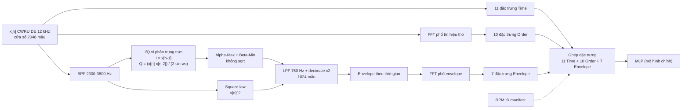

# Giải điều chế envelope nhân quả không FFT cho chẩn đoán lỗi vòng bi trên STM32F4

> Khảo sát đánh đổi giữa **độ trung thực của đường bao** và **chi phí thực** (chu kỳ, SRAM, Flash, độ trễ) của pipeline DSP + Edge AI trên Cortex-M4F, nếu có board để đo. Dữ liệu: CWRU Drive-End 12 kHz.

| | |
|---|---|
| **Dataset** | CWRU Bearing Data Center, Drive-End, 12 kHz, 4 lớp |
| **Nền tảng** | STM32 - ARM |
| **Mô hình chính** | MLP trên 28 đặc trưng thủ công |
| **Mở rộng tùy chọn** | CNN/INT8, chỉ thực hiện nếu còn thời gian sau khi hoàn tất câu hỏi chính |
| **Trạng thái** | Đang thiết kế và triển khai. **Chưa có kết quả đo**: mọi ô `[TBD]` chờ số liệu thực. |

---

## 1. Tóm tắt

Biến đổi Hilbert qua FFT cho đường bao chuẩn, nhưng xử lý theo khối, cần bộ nhớ số phức và chỉ trả kết quả sau khi thu đủ cửa sổ. Dự án khảo sát một khối giải điều chế envelope **nhân quả, không FFT** cho vi điều khiển. Claim này chỉ nói về phép tạo envelope; FFT vẫn được dùng riêng ở bước trích đặc trưng phổ, bao gồm Order và Envelope:

1. Tín hiệu đi qua BPF **2300-3800 Hz** (tâm ≈ 3050 Hz, gần fs/4).
2. Cặp trực giao được tạo bằng **vi phân trung tâm chuẩn hóa**: `I[n] = x[n-1]`, `Q[n] = (x[n] - x[n-2]) / (2·sin ωc)`.
3. Biên độ tính bằng **Alpha-Max Plus Beta-Min**, không dùng căn bậc hai.
4. Đường bao qua **LPF 750 Hz** rồi **decimate ×2** (1024 mẫu), sau đó trích 7 đặc trưng envelope cho MLP.

Đóng góp là một **đánh đổi được lượng hóa**, không phải tuyên bố tối ưu:

- **Độ trung thực:** đường bao Hybrid và Square-law được đối chiếu với tham chiếu FFT Hilbert.
- **Chi phí:** đo trên phần cứng thật, theo từng giai đoạn của pipeline.
- **Tác động lên phân loại:** đánh giá MLP theo giao thức chống rò rỉ dữ liệu.

## 2. Điểm nhấn

- **Không FFT trong khối giải điều chế.** Không đệm khối, không số phức, trạng thái chỉ 2 mẫu.
- **Không sqrt ở nhánh Hybrid.** Biên độ đường bao tính bằng `α·max + β·min`; Square-law được đưa vào làm baseline đơn giản bằng cách bình phương tín hiệu sau BPF.
- **Rất rẻ theo cấu trúc.** Khối I/Q cần 1 phép trừ và 1 phép nhân mỗi mẫu. Trễ nhóm là 1 mẫu (≈ 83 µs ở 12 kHz). Độ lệch pha đúng 90° ở mọi tần số.
- **Hợp với dải cộng hưởng đã chọn.** Tâm dải gần fs/4, nơi bộ vi phân 3 tap gần lý tưởng nhất (mục 4.2).
- **Đo thật, không chỉ ước lượng.** Chu kỳ bằng DWT trên board; SRAM và Flash của cả firmware, không chỉ của mạng.
- **Giao thức đánh giá chống rò rỉ.** File là đơn vị chia tập, manifest cố định, stratified group k-fold lặp N seed với cùng tập seed cho mọi phương án (so sánh cặp).
- **Báo cáo trung thực giới hạn.** Độ nghiêng biên độ, phụ thuộc RPM, phạm vi CWRU đều được nêu và đo, không giấu.

## 3. Pipeline

### 3.1. Thứ tự khóa dữ liệu và cấu hình

1. **Lập manifest từ dữ liệu gốc:** kiểm tra nhãn, tải, vị trí cảm biến, số mẫu, sampling rate và RPM; lọc scope rồi lưu manifest kèm SHA-256. Mọi bước tiếp theo dùng metadata đã chốt trong manifest, không tự suy ra lại RPM hay sampling rate.
2. **Rà miền thời gian:** kiểm tra chất lượng tín hiệu sau resample về 12 kHz (độ dài, biên độ, clipping, đoạn bất thường và transient). Bước này xác nhận dữ liệu dùng được; không tự chọn bandpass từ một file đại diện.
3. **Rà miền tần số:** so sánh phổ trên các lớp lỗi và tải trong tập được phép dùng để thiết kế; không dùng file Test để chọn band. Các band theo từng loại lỗi trong `outputs/configs/bands/` chỉ là kết quả khảo sát.
4. **Khóa một bandHz chung:** dùng **2300–3800 Hz** cho mọi lớp/tải. Không chọn band theo từng file hoặc nhãn trong pipeline chính. Đây là cấu hình thực nghiệm đã chốt, đồng thời đặt dải cộng hưởng gần fs/4 cho khối Hybrid; không tuyên bố đây là band tối ưu phổ quát.
5. **Build feature:** resample theo manifest, tính envelope trên toàn file để giữ trạng thái lọc, cắt raw/envelope đồng vị trí sau warm-up, dùng FFT để trích đặc trưng phổ Order và Envelope, rồi tạo 28 đặc trưng (11 Time + 10 Order + 7 Envelope).
6. **So sánh envelope và sai số:** với cùng tín hiệu, BPF/LPF và cấu hình, so Hybrid và Square-law với tham chiếu Hilbert offline. Báo cáo tương quan Pearson và NRMSE sau warm-up; căn chỉnh trễ trước khi so sai số dạng sóng, đồng thời ghi lag để không che mất độ trễ. So sánh phổ envelope tại các tần số lỗi và lưu sai số theo file.
7. **So sánh phân loại:** dùng cùng manifest, cửa sổ, nhóm file và fold/seed cho các bảng feature Hybrid, Square-law và Hilbert; không trộn kết quả độ trung thực envelope với kết quả phân loại.



**Các nhánh so sánh (cùng BPF, LPF, decimate):**

| Nhánh | Vai trò | Ghi chú |
|---|---|---|
| **Hybrid** (I/Q vi phân + Alpha-Max) | Phương án đề xuất | Nhân quả, theo dòng mẫu; xấp xỉ biên độ không cần căn bậc hai |
| **Square-law** (`x[n]^2`) | Baseline đơn giản | Bình phương tín hiệu sau BPF rồi LPF; rẻ về cấu trúc nhưng đặc tính đường bao khác Hybrid/Hilbert |
| **FFT Hilbert** (masking bin dương) | Tham chiếu chuẩn | Không nhân quả, xử lý theo khối. Dùng làm thước đo độ trung thực, không coi là triển khai MCU tương đương |

> **Phạm vi của claim "không FFT":** chỉ áp dụng cho khối giải điều chế/tạo envelope Hybrid và Square-law. Trích đặc trưng phổ vẫn dùng FFT: Order tính trên phổ tín hiệu thô và Envelope tính trên phổ của envelope. Vì vậy toàn bộ pipeline **có sử dụng FFT**; chỉ riêng khối tạo envelope Hybrid/Square-law là không FFT. Chi phí FFT của các bước trích đặc trưng được tính riêng, không gộp vào claim về giải điều chế.

## 4. Thông số DSP

### 4.1. Bảng thông số

| Thông số | Giá trị | Ghi chú |
|---|---|---|
| fs | 12 kHz | Các file Normal 48 kHz được hạ về 12 kHz bằng polyphase |
| Cửa sổ | 2048 mẫu (170,67 ms) | Stride: 1024 mẫu |
| BPF (dải cộng hưởng) | **2300-3800 Hz**, cố định cho mọi lớp và tải | Butterworth bậc 4, causal SOS. Nguồn chọn dải và tập dùng để chọn cần ghi trong báo cáo; không dùng file Test |
| ωc | Chế độ `minimax` | Giảm sai lệch tương đối lớn nhất của gain Q trên dải; `center` là đối chứng trong `00_hybrid_testing.ipynb` |
| Alpha-Max | α = 0,960433870103; β = 0,397824734759 | Tối ưu sai số cực đại, theo hằng số hiện hành trong `common.dsp` |
| LPF | **750 Hz** | Butterworth bậc 2, causal SOS. Giữ tối thiểu hài bậc 3 của BPFI (mục 4.3) |
| Decimate | **×2** → fs_env = 6 kHz, **1024 mẫu** | Cấu hình chính; không quét thêm hệ số giảm mẫu trong phạm vi hiện tại |

Biên độ xấp xỉ:

```
|z| ≈ α·max(|I|, |Q|) + β·min(|I|, |Q|)
```

Nhánh **Square-law baseline** dùng tín hiệu đã qua BPF:

```text
u[n] = x_BPF[n]^2
 envelope_sq[n] = LPF(u[n]) rồi decimate ×2
```

Square-law không phải biên độ Hilbert chính xác; cần so sánh sai số đường bao và phổ tại tần số lỗi với cùng điều kiện BPF/LPF. Khi so sánh phân loại, dùng đúng cùng cửa sổ, manifest, fold và seed như Hybrid và FFT Hilbert.

### 4.2. Độ nghiêng biên độ của khối I/Q

Với `x = cos(ωn)`, `Q/I` có biên độ `s = sin ω / sin ωc` và lệch pha đúng 90°. Độ nghiêng `s` là điểm yếu của phương án này. Ước lượng giải tích với dải 2300-3800 Hz và `fc = 3050 Hz` (đây là ước lượng lý tưởng, chưa phải số đo):

| Tần số | s = sinω / sinωc | Image rejection ≈ ((1-s)/(1+s))² |
|---|---|---|
| 2300 Hz |||
| 3050 Hz |||
| 3800 Hz |||

### 4.3. Kiểm tra LPF 750 Hz với tần số lỗi

Theo hệ số công bố BPFI ≈ 5,415 × f_r (cần xác nhận trước khi trích dẫn), ở 1797 rpm (f_r ≈ 29,95 Hz):

| | Tần số |
|---|---|
| BPFI | ≈ 162 Hz |
| Hài bậc 3 | ≈ 487 Hz |
| Hài bậc 4 | ≈ 649 Hz (sát vùng chuyển tiếp, phụ thuộc độ dốc LPF) |
| Hài bậc 5 | ≈ 811 Hz (ngoài băng) |

## 5. Dữ liệu và manifest

**Nhãn 4 lớp:** Normal + 3 vị trí lỗi (IR, B, OR) × 3 đường kính (7, 14, 21 mil). Gom chung các mức tải 0, 1, 2, 3 HP. (4 Lớp: Normal, IR, OR, B)

Manifest chuẩn được tạo từ dữ liệu gốc, lọc theo scope, gắn fold và băm SHA-256 trước khi build feature. Cột RPM dùng cho đặc trưng được quyết định tại bước manifest: ưu tiên RPM đọc từ file nếu hợp lệ, nếu không dùng RPM danh định theo tải và ghi rõ nguồn. Feature builder không tự tính lại hoặc thay thế RPM.

| Cột | Ý nghĩa |
|---|---|
| `file_path` | Đường dẫn file `.mat` nguồn |
| `label`, `load_hp`, `fault_diameter_mils`, `or_position` | Nhãn và metadata dùng để xác định scope/lớp |
| `declared_sample_rate_khz`, `resolved_sample_rate_hz` | Tần số khai báo và tần số được xác thực từ metadata/số mẫu |
| `rpm_from_file`, `rpm` | RPM gốc đọc được và RPM thống nhất dùng cho đặc trưng |
| `rpm_source` | `measured` hoặc `imputed:<quy tắc>` |
| `warnings`, `has_warning`, `manifest_schema_version` | Kết quả sanity check và phiên bản schema |
| `fold_seed_<seed>` | Fold của file ứng với từng seed; các cửa sổ sau đó kế thừa fold qua `file_id` |

**Quy tắc:**
- Quy tắc RPM thiếu hiện tại là RPM danh định theo tải (`NOMINAL_RPM_BY_LOAD`); nguồn điền được ghi trong `rpm_source`. Nếu không có RPM hợp lệ cũng không xác định được tải thì dừng, không dùng giá trị mặc định ngầm.
- Manifest sau scope/fold được băm (SHA-256) và ghi vào log mỗi lần chạy. Bảng feature bổ sung `file_id` (stem, không chứa chỉ số cửa sổ), `window_idx` và `start_idx`.
- Nếu RPM được điền theo tải danh định thì RPM tương quan với tải. Khảo sát độ nhạy khi RPM lệch ±2% được đưa vào thực nghiệm.

**Kiểm kê hiện tại:** 40 file trong scope, 4 file cho mỗi lớp 10-class. Số lượng theo tải cần lấy từ manifest đã sinh; không giả định mọi lớp đều có cùng số file ở từng tải.

## 6. Giao thức đánh giá

| Mục | Thiết kế |
|---|---|
| **Giao thức** | **Stratified group k-fold, nhóm = `file_id`**: mỗi file được test đúng một lần trong một seed; mọi cửa sổ cùng file ở cùng fold. Hiện có 4 file/lớp nên `k = 4` |
| **Lặp N seed** | Mỗi seed ứng với một cách phân hoạch fold và một khởi tạo MLP. Dùng seed 42–51 (`N = 10`), báo cáo đủ cả 10 lần. Hybrid, Square-law và FFT Hilbert dùng cùng tập seed/fold để so sánh cặp |
| **Điều kiện kiểm kê** | Chỉ chạy được khi mỗi lớp có ≥ k file (bảng kiểm kê, mục 5). Nếu có lớp ít file hơn thì giảm k |
| **Chỉ fit trên Train** | Z-score và siêu tham số học được. Cấu hình DSP (BPF, ωc, α/β) phải chốt từ trước, không chọn dựa trên Test |
| **Chọn mô hình / early stopping** | Cấu hình MLP và số epoch cố định trước (hoặc chọn trên fold phát triển riêng), **không** theo Test. Chỉ tách Val theo file khi số file mỗi lớp cho phép |
| **Báo cáo** | Accuracy, Macro-F1 gộp theo file qua k fold của mỗi seed, rồi mean ± std qua N seed; accuracy theo file; confusion matrix; CI bootstrap theo file. Không tính std trên cửa sổ |
| **Không dùng p-value từ N seed** | Đơn vị độc lập là file; các seed dùng chung file Test nên không độc lập. Bất định theo file lấy từ bootstrap theo file |
| **Chống ceiling effect** | Quét SNR (cộng nhiễu trắng vào tín hiệu thô) `[TBD: các mức SNR]` |

**Giới hạn đã biết của giao thức:** cùng một vòng bi hỏng xuất hiện ở cả 4 mức tải, nên file Test luôn có file "cùng lỗi, khác tải" nằm trong Train. Kết quả chỉ nói về file chưa thấy trong cùng mẫu vật với tải gộp chung, và **không tuyên bố tổng quát hóa qua tải hay qua vòng bi/máy khác**. Nếu Accuracy chạm trần, bổ sung một phép thử SNR đã chốt trước; không mở rộng thành nhiều ma trận mô hình.

## 7. Mô hình

| Mô hình | Đầu vào | Ghi chú |
|---|---|---|
| **MLP (duy nhất trong benchmark chính)** | 28 đặc trưng: 11 Time + 10 Order + 7 Envelope | Z-score fit trên Train. Nhóm Order cần RPM; nguồn của từng nhóm đặc trưng phải ghi rõ |

CNN và INT8 giữ trong mã nguồn như hướng mở rộng, không phải điều kiện hoàn thành hay cơ sở cho kết luận chính. Chỉ mở rộng sau khi benchmark MLP và câu hỏi DSP đã hoàn tất.

## 8. Đo đạc trên STM32F4

| Metric | Định nghĩa và cách đo |
|---|---|
| **Chu kỳ (cycles)** | DWT `CYCCNT` trên board. Báo cáo theo giai đoạn: DSP / đặc trưng / suy luận. Trung bình, min, max trên nhiều cửa sổ. Loại trừ thời gian I/O. Nêu cờ biên dịch |
| **MACC** | Chỉ báo cáo nếu công cụ xuất được; là phép tính **tĩnh** của mạng, không phải chu kỳ |
| **Flash** | Toàn bộ firmware (`.text` + `.rodata`), gồm bảng twiddle và runtime. Trọng số mô hình báo riêng |
| **SRAM** | Đỉnh toàn firmware: bộ đệm cửa sổ, trạng thái bộ lọc, activation arena, stack (từ map file và stack watermark) |
| **Inference latency** | Chỉ phần suy luận NN |
| **Diagnostic latency** | DSP + đặc trưng + suy luận cho một cửa sổ |
| **Post-window latency** | Thời gian từ mẫu cuối đến kết quả. Hybrid và Square-law có thể tạo đầu ra theo dòng mẫu; sau khi đủ cửa sổ, các phương án vẫn phải tính đặc trưng Order/Envelope (có FFT) và suy luận. Nếu dùng FFT Hilbert để tạo envelope tham chiếu thì bước đó cũng cần cửa sổ đầy đủ |
| **Duty cycle** | `cycles_diag / (f_clk × T_cửa sổ)`, với T_cửa sổ = 170,67 ms |
| **Tiêu chí real-time** | `t_diag < stride / fs`. Chỉ dùng từ "real-time" khi thỏa tiêu chí này |
| **Energy** | Ngoài phạm vi chính; chỉ bổ sung nếu có dụng cụ đo dòng phù hợp và số đo thực. Không ước lượng hoặc điền số danh định |

Kiểm tra bắt buộc trước khi đo: **khớp số học PC vs MCU** trên cùng cửa sổ (đường bao, đặc trưng, đầu ra mạng).

## 9. Bảng kết quả (khung, chờ số liệu)

**Bảng 1 — Khối DSP** (đơn vị chung: một cửa sổ 2048 mẫu)

**Bảng 1 — Độ trung thực đường bao trên PC**

| Phương án | Tương quan ρ | NRMSE | Suy giảm SNR đỉnh phổ tại tần số lỗi |
|---|---|---|---|
| Hybrid (minimax) | `[TBD]` | `[TBD]` | `[TBD]` |
| Square-law | `[TBD]` | `[TBD]` | `[TBD]` |
| FFT Hilbert (tham chiếu) | 1 | 0 | 0 dB |

**Bảng 2 — Ablation 2×2** (độ trung thực đường bao, trên PC)

| | Alpha-Max | sqrt chính xác |
|---|---|---|
| **I/Q vi phân** | Hybrid đầy đủ | Chỉ có sai số I/Q |
| **FFT Hilbert** | Chỉ có sai số Alpha-Max | Tham chiếu |

**Bảng 3 — Phân loại chính:** Accuracy / Macro-F1 của MLP (mean ± std qua N seed, kèm CI bootstrap theo file), so sánh Hybrid, Square-law với FFT Hilbert trên cùng fold/seed. Ablation nhóm đặc trưng Time / +Order / +Envelope chỉ thực hiện nếu cần giải thích đóng góp của từng nhóm.

**Bảng 4 — MCU (có điều kiện):** chỉ pipeline MLP chính, nếu có board và hoàn thành port. Báo cáo cycles theo giai đoạn, duty cycle, Flash và SRAM thực đo/đọc từ map; bỏ Energy nếu không có số đo.

Khi đo MCU, ghi riêng cấu hình lọc dùng chung và chi phí phần giải điều chế; không so sánh số đo Hilbert offline như thể đó là một triển khai MCU.

## 10. Câu hỏi nghiên cứu và giả thuyết

- **RQ1.** Khối Hybrid và Square-law giữ được bao nhiêu độ trung thực đường bao so với FFT Hilbert, và chi phí DSP thực tế ra sao? Chỉ kết luận về cycles/bộ nhớ/latency MCU nếu đã đo trên board.
- **RQ2.** Với MLP 28 đặc trưng, thay đường bao Hybrid hoặc Square-law bằng FFT Hilbert có làm thay đổi Accuracy/Macro-F1 theo file không, dưới cùng giao thức group k-fold lặp N seed?

Giả thuyết dạng non-inferiority, **ngưỡng chọn trước khi chạy**:
- **H1:** ρ(Hybrid, FFT Hilbert) ≥ ρ₀ và SNR đỉnh phổ tại tần số lỗi sụt không quá x dB.
- **H2:** Macro-F1 của MLP dùng Hybrid không kém tham chiếu FFT Hilbert quá δ điểm phần trăm. Nếu có quét SNR, các mức nhiễu và tiêu chí phải được chốt trước.

Kết luận âm tính (Hybrid/Square-law mất nhiều độ trung thực, hoặc tiết kiệm chỉ khiêm tốn vì BPF/LPF chiếm phần lớn chu kỳ) cũng là kết quả hợp lệ và sẽ được báo cáo.

## 11. Giới hạn và phạm vi

**Hai giới hạn kỹ thuật lớn nhất:**

1. **Độ trung thực phụ thuộc giả thiết băng hẹp quanh fs/4.** Bộ vi phân 3 tap gần lý tưởng khi dải cộng hưởng nằm gần 3 kHz. Với máy, vòng bi hay vị trí cảm biến khác, dải cộng hưởng thay đổi thì độ nghiêng biên độ tăng, và sai số Alpha-Max có thể gập vào dải đường bao. Cần hiệu chỉnh lại ωc và dải lọc theo từng hệ thống.
2. **Bằng chứng chỉ trong phạm vi CWRU.** Cùng mẫu vật xuất hiện ở mọi mức tải, nên chưa chứng minh tổng quát hóa sang vòng bi hay máy khác. Đặc trưng Order cần RPM từ nguồn ngoài. Kết luận về tài nguyên chỉ áp dụng cho nền tảng đã đo.

**Giới hạn khác:**
- Bộ lọc dùng chung (BPF, LPF) có thể chiếm phần lớn chu kỳ, khiến lợi ích của khối I/Q chỉ là một phần nhỏ của tổng.
- MLP xử lý theo cửa sổ 2048 mẫu, nên vẫn cần bộ đệm đủ lớn. Lợi thế "theo dòng mẫu" chỉ nằm ở tầng DSP.
- File Normal được hạ mẫu 48 → 12 kHz còn file lỗi là gốc 12 kHz; cần kiểm tra ảnh hưởng của resampling, dù mọi pipeline sau đó dùng chung fs 12 kHz.
- IIR All-Pass trực giao (độ lệch biên độ phẳng hơn) thuộc hướng phát triển, không nằm trong phạm vi hiện tại.

## 12. Lộ trình theo cổng

| Cổng | Nội dung | Điều kiện đi tiếp |
|---|---|---|
| **1 (PC)** | Khóa cấu hình minimax, kiểm tra Hybrid, Square-law vs FFT Hilbert trên tone và tín hiệu thật; đo độ trung thực đường bao | Đạt tiêu chí đã định trước hoặc ghi nhận kết quả âm tính |
| **2 (PC)** | MLP 28 đặc trưng, Hybrid, Square-law vs FFT Hilbert; group k-fold theo file, N = 10 seed dùng chung | Hoàn thành metric file-level và phân tích sai số |
| **3 (MCU, có điều kiện)** | Port pipeline chính sang C, khớp số học PC vs MCU; đo cycles/bộ nhớ nếu có board |

## 13. Cấu trúc kho mã (đề xuất, chỉnh theo kho thực tế)


## 14. Việc cần chốt trước khi chạy thực nghiệm

- [ ] Xác nhận thống kê file theo lớp × tải từ manifest cuối
- [ ] Ghi nguồn và cách chọn dải cộng hưởng 2300-3800 Hz; bảo đảm không dùng Test để chọn
- [ ] Chốt quy tắc RPM thiếu và provenance trong manifest
- [ ] Chốt nguồn dữ liệu của từng nhóm đặc trưng và cấu hình MLP/epoch trước khi benchmark
- [ ] Nếu đo MCU: part number STM32F4, xung nhịp, toolchain; nếu không có board thì giới hạn kết luận ở PC

## 15. Trích dẫn

- Dữ liệu: Case Western Reserve University Bearing Data Center.
- Related work (xấp xỉ Alpha-Max, Hilbert/giải điều chế đường bao, TinyML cho chẩn đoán vòng bi): `[TBD]`
